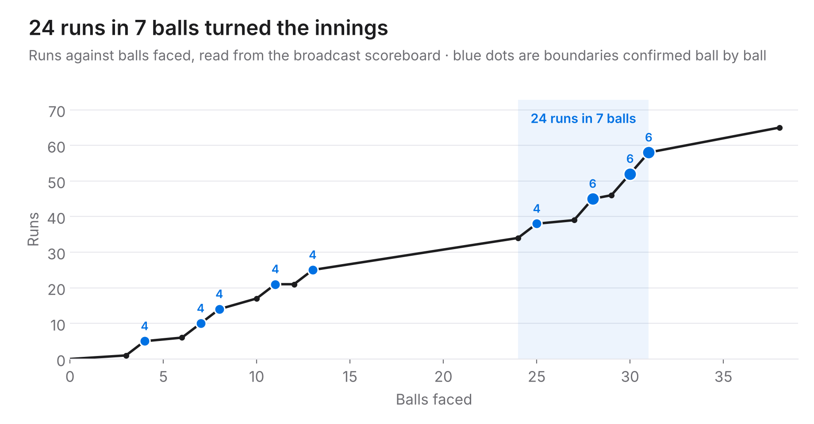
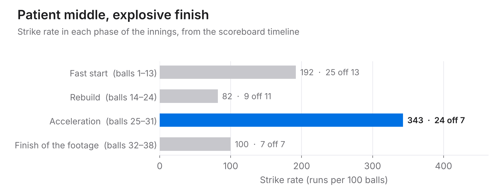
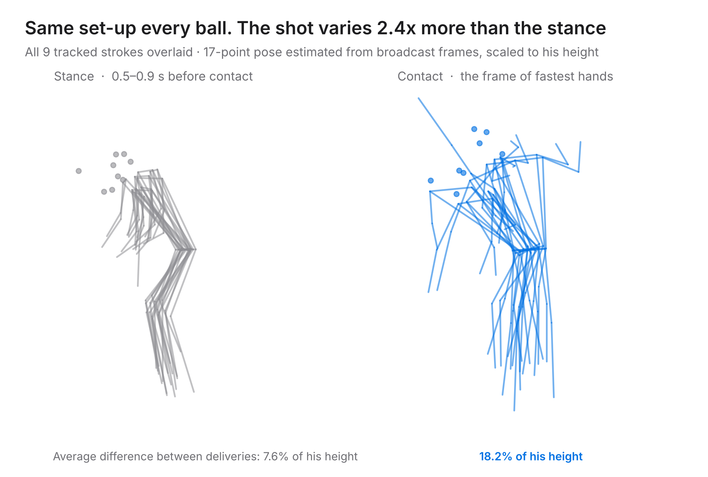

# First Computer Vision Project

**A computer watches two and a half minutes of cricket highlights and rebuilds the innings, ball by ball and stroke by stroke.**

| Frames analysed | Scoreboard readings | Strokes tracked | Body points per frame |
|:-:|:-:|:-:|:-:|
| **3,976** | **246** | **9** | **17** |



## Why

Highlights show the big moments but not how an innings was built. Broadcast video already carries the data: the scoreboard on screen and the batter's body in every frame. This project uses computer vision to read both and turn them into something a coach or analyst can work with.

## Approach

| | |
|---|---|
| **Input** | 146 s of broadcast highlights (2388×1668, 3,976 frames) of my 73 off 44 for Thiruvallur in the S.S. Rajan Trophy. |
| **1 · Read the scoreboard** | OCR (RapidOCR + Tesseract) on the scoreboard strip every 0.5 s. Readings are cleaned so runs and balls never go down and always agree with the team total. |
| **2 · Cut into camera shots** | Colour-histogram change between frames finds 45 camera shots; an object detector (YOLO11) labels the 15 filmed from the main delivery camera. |
| **3 · Find the batter** | YOLO11 detects every player; the striker is the one standing at the far crease in the main camera's frame. |
| **4 · Estimate his pose** | YOLO11-pose estimates 17 body points in every frame. Each stroke is centred on the hips and scaled to his height, so camera zoom doesn't matter. |
| **Checks** | Every scoreboard state was cross-checked against the team total. All 9 strokes were checked by eye to confirm the tracked player is the striker; clips from other camera angles were excluded. |

## Results

**The innings, read from the screen.** The scoreboard OCR rebuilt 17 states of the innings, from 1 (3) to 65 (38). The final 73 (44) comes from the broadcast title.



- **24 runs in 7 balls** (balls 25–31) turned the innings: a four and then three sixes in four balls.
- **Five fours in the first 13 balls**, then a rebuild of 9 off 11 while the opening stand ended.
- **At least 42 of the 65 runs** in the footage came from 9 boundaries confirmed ball by ball.

**How he moved.** Nine strokes were tracked frame by frame; the scoreboard links eight of them to their outcome (six fours, two sixes).



- **Same set-up every ball.** Across the nine strokes, his stance varies by 7.6% of his height. At contact, the shapes vary 2.4 times more (18.2%). The base stays fixed while the shot adapts to the ball.

## Limitations

- Highlights skip balls. Between some readings only the total over several balls is known.
- The batter is about 150 pixels tall in broadcast video. Pose is reliable for overall body shape, not for fine joint angles.
- The scoreboard position and main-camera geometry are set for this broadcast. Another broadcast needs them set again.
- Nine strokes describe one innings. They show a pattern, not a general rule.

## Run it

```bash
pip install -r requirements.txt          # plus the tesseract binary
python src/run_all.py innings.mov        # see data/README.md for the video
```

Or open [`notebooks/first_computer_vision_project.ipynb`](notebooks/first_computer_vision_project.ipynb) in Colab. Each step caches its output in `outputs/work/`, so the derived data in this repository reproduces the charts without the video.

## Repository

```
src/scoreboard.py     OCR of the on-screen scoreboard
src/timeline.py       cleans readings into an innings timeline
src/scenes.py         splits the video into camera shots
src/shots.py          labels the main delivery camera
src/pose.py           finds the striker and estimates his pose
src/strokes.py        finds and measures each stroke
src/build_outputs.py  combines everything into outputs/metrics.json
src/charts.py         the charts above
src/run_all.py        runs the whole pipeline
```

## Why this innings

I'm a professional cricketer. This is my innings in the final for my district, Thiruvallur. R. Ashwin was the chief guest, I was named player of the final, and he then picked me for his TNPL team, Dindigul Dragons. My first computer vision project had to start here.

---

<sub>Hemanth Kumar Gopi · <a href="https://hemanthkumargopi.vercel.app">hemanthkumargopi.vercel.app</a> · Footage: FanCode broadcast (not redistributed) · Models: Ultralytics YOLO11 (AGPL-3.0)</sub>
